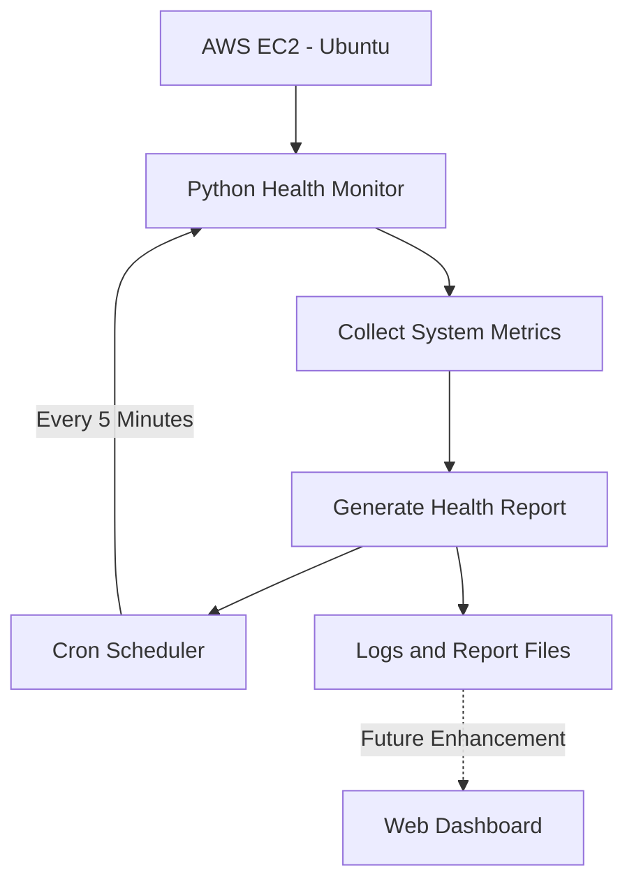

# 👋 Hi there, I'm Santhosh Kumar!

### 🐧 Linux | ☁️ AWS Cloud | 🚀 DevOps Engineering

**Learning by doing. Automating with purpose. Building real-world solutions.**

I am building my technical skills through hands-on projects, practical labs, automation, troubleshooting, and structured documentation.

---

## 👨‍💻 About Me

- 🐧 Learning Linux administration, filesystem management, permissions, and troubleshooting.
- ☁️ Exploring AWS services, cloud infrastructure, networking, and security.
- 🚀 Developing practical knowledge of DevOps tools and workflows.
- 💻 Practicing Python and Bash scripting for automation.
- 🔄 Learning Git, GitHub, CI/CD, and infrastructure automation.
- 🛠️ Building hands-on projects using Linux and AWS EC2.
- 📚 Documenting technical concepts in structured notes for revision and interview preparation.
- 🎯 Focused on becoming a skilled cloud and DevOps engineer through continuous practice.

> My approach: Understand the fundamentals, practice in a real environment, troubleshoot issues, document the solution, and automate repetitive tasks.

---

## 🛠️ Tech Stack & Tools

### 🐧 Operating Systems

### ☁️ Cloud & Infrastructure

### 🚀 DevOps & Version Control

### 💻 Programming & Automation

---

## 📌 Featured Learning Repositories

### 🐧 1. Linux & DevOps Learning Notes

A structured knowledge base for learning and revising Linux and DevOps concepts.

**Topics include:**
- Linux fundamentals and architecture
- Filesystem structure and essential commands
- Users, groups, permissions, and ownership
- Processes, services, and system administration
- Bash scripting and automation
- Troubleshooting and log analysis
- DevOps fundamentals and learning roadmap
- Interview preparation notes

**Repository:** [Linux-DevOps-Notes](https://github.com/santhosh2958-dot/Linux-DevOps-Notes)

### ☁️ 2. AWS Complete Learning Notes

A practical learning resource for AWS cloud services and infrastructure.

**Topics include:**
- Cloud computing fundamentals
- AWS global infrastructure: Regions and Availability Zones
- IAM, access management, and security
- EC2 instances and Linux web servers
- EBS volumes, AMIs, and snapshots
- VPC, subnets, route tables, and security groups
- S3 storage and AWS CLI
- Load Balancers and Auto Scaling
- CloudWatch monitoring and CloudTrail
- Systems Manager, Lambda, and serverless
- CloudFront and Route 53
- Terraform, containers, and AI fundamentals
- Hands-on exercises and interview preparation

**Repository:** [AWS-Complete-Learning-Notes](https://github.com/santhosh2958-dot/AWS-Complete-Learning-Notes)

---

## 🚀 Hands-on Projects

| Project | Technologies | Learning Focus |
|---|---|---|
| [EC2 Server Health Monitor](https://github.com/santhosh2958-dot/aws-ec2-server-health-monitor) | Python, Linux, AWS EC2, Cron | Automated server health reporting |
| Linux System Health Report | Linux, Bash | System information and health checks |
| File Backup Automation | Bash, `tar`, Cron | Scheduled backups |
| Disk Usage Monitoring | Linux, Bash | Disk capacity monitoring |
| Linux Driver Validation | Python, Linux | Automated driver and file validation |
| AWS EC2 Web Server | AWS EC2, Ubuntu, Nginx | Web server deployment |
| S3 Backup Practice | Amazon S3, AWS CLI | Cloud storage and backup |
| Cloud Infrastructure Practice | AWS, Terraform | Infrastructure as Code |
| Container Deployment Practice | Docker, Kubernetes | Containerization fundamentals |

> These projects represent my learning and practice activities. I will continue improving the documentation and adding implementation details as I progress.

### ⭐ Featured Project: EC2 Server Health Monitor

My goal is to build a practical monitoring solution that automatically collects essential Linux server metrics on an AWS EC2 instance.

**Planned capabilities:**
- Collect hostname, disk usage, memory usage, and CPU load average.
- Generate a readable health report.
- Run the monitoring script automatically every five minutes using Cron.
- Maintain logs for troubleshooting and verification.
- Extend the project with a dashboard that displays the latest report.

**Architecture:**

**Current learning focus:** Linux monitoring, Python automation, Cron scheduling, log management, and AWS EC2 administration.

**Project repository:** [aws-ec2-server-health-monitor](https://github.com/santhosh2958-dot/aws-ec2-server-health-monitor)

---

## 📚 Currently Learning

- 🐧 Linux administration and troubleshooting
- ☁️ AWS cloud architecture and core services
- 🐍 Python scripting and automation
- 💻 Bash scripting and essential Linux commands
- 🌿 Git and GitHub workflows
- 🐳 Docker and containerization
- ☸️ Kubernetes fundamentals
- 🏗️ Terraform and Infrastructure as Code
- 🔄 CI/CD pipelines and DevOps practices
- 📈 Monitoring, logging, and operational automation

---

## 📊 GitHub Statistics

*GitHub statistics are generated by a third-party service and may occasionally be unavailable. Language statistics reflect repository contents, not necessarily overall proficiency.*

---

## 🌱 My Learning Philosophy

### Learn → Practice → Troubleshoot → Document → Automate → Build

I believe that strong technical skills come from understanding fundamentals and applying them in practical environments.

Every project is an opportunity to learn something new, solve a problem, improve documentation, and build confidence.

I focus on steady progress rather than shortcuts—one command, one concept, and one project at a time.

---

## 📫 Connect With Me

- **GitHub:** [@santhosh2958-dot](https://github.com/santhosh2958-dot)
- **Learning repositories:** [Linux & DevOps Notes](https://github.com/santhosh2958-dot/Linux-DevOps-Notes) · [AWS Learning Notes](https://github.com/santhosh2958-dot/AWS-Complete-Learning-Notes)

<!-- Add your LinkedIn profile and professional email here when ready. -->

---

### ⭐ Keep Learning | Keep Practicing | Keep Growing

**Building my Linux, AWS, Python, and DevOps skills one step at a time. 🚀**

